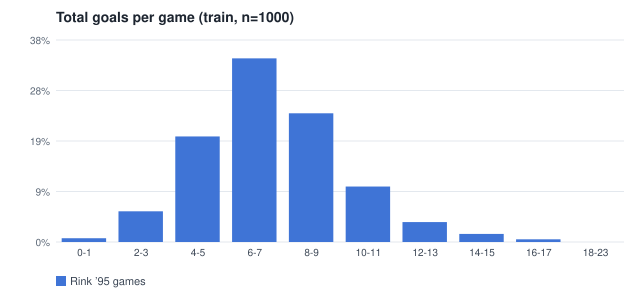
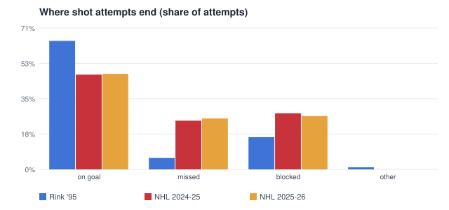
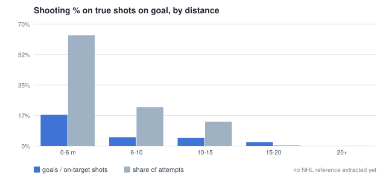
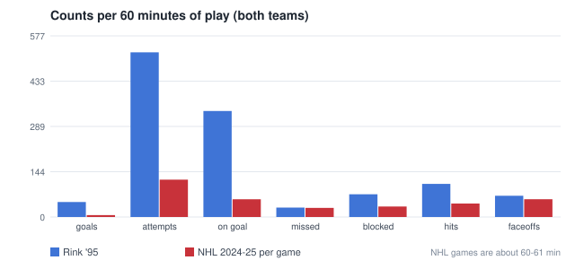
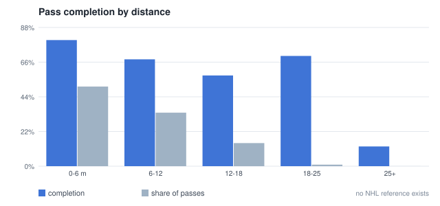
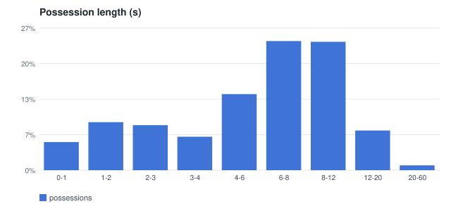

# Rink '95 calibration report: baseline

Generated by `calibration/report.mjs` from evaluator output. **This is a baseline measurement, not a validation.** Nothing in it shows the game resembles real hockey; it shows where it does and does not.

| Run | Set | Seeds | Commit | Sim changed since commit | Games |
|---|---|---|---|---|---|
| baseline-holdout-0-499.jsonl.gz | holdout | holdout-0…holdout-499 | b4769f9 | no | 500 |
| baseline-train-0-999.jsonl.gz | train | train-0…train-999 | b4769f9 | no | 1000 |

## 1. Run integrity

| | train | holdout |
|---|---|---|
| games / completed / errors | 1000 / 1000 / 0 | 500 / 500 / 0 |
| result REG / OT / SO | 869 / 128 / 3 | 428 / 71 / 1 |
| clock time in play (s), mean | 550.0 | 551.7 |
| sim time incl. stoppages (s), mean · p95 | 575 · 638 | 577 · 657 |
| compute per game (ms), mean | 9930 | 9964 |

## 2. Identities (measurement integrity)

Share of games where each identity holds exactly (train). Anything below 100% or non-zero is a lineage defect to explain, not noise.

| Identity | Result |
|---|---|
| score = number of goal events | 100.0% |
| sim shot counter = observed shot attempts | 100.0% |
| attempts = goals + saves + missed + blocked + blocked-by-teammate + short + other | 100.0% |
| passes = completions + interceptions + other | 100.0% |
| faceoffs = opening + period starts + goals + freezes | 99.7% |
| sim save counter minus lineage saves, per game | 0.33 (saves the sim credits that the observer cannot tie to a live shot) |
| goals not from a tracked shot (total, all games) | 454 |
| observer issues | save-of-off-target-shot: 10159, save-without-active-shot: 331, crossed-mouth-no-goal: 13 |

## 3. Headline comparison

Train and holdout: mean [95% CI] for counts, ratio [bootstrap 95% CI] for rates. NHL values are all situations, regular season, both teams, per full game; Rink ’95 regulation is 9 minutes of clock with no penalties, so **shares and percentages are the fair comparison**; counts are shown per 60 minutes of play only as a pacing indicator.

| Measure | Rink ’95 train | Rink ’95 holdout | NHL 2024-25 · 2025-26 |
|---|---|---|---|
| shot attempts on goal (true, on target) | 64.4% [64.0%, 64.7%] | 64.9% [64.4%, 65.3%] | 47.5% · 47.8% |
| shot attempts on goal (as the sim credits them) | 77.1% [76.8%, 77.4%] | 77.5% [77.1%, 77.9%] |  |
| shot attempts missed | 5.7% [5.5%, 5.9%] | 5.6% [5.3%, 5.8%] | 24.4% · 25.5% |
| shot attempts blocked (incl. by teammate) | 16.1% [15.9%, 16.4%] | 15.9% [15.5%, 16.2%] | 28.1% · 26.7% |
| save % (true shots on goal) | 86.8% [86.5%, 87.1%] | 86.9% [86.4%, 87.3%] | 90.0% · 89.6% (excl. empty net) |
| save % (as the sim credits it) | 89.0% [88.7%, 89.2%] | 89.0% [88.6%, 89.3%] |  |
| saves of shots that were going wide | 18.5% [18.2%, 18.8%] | 18.3% [17.8%, 18.7%] | not applicable (scorers don’t credit them) |
| shooting % on true shots on goal | 13.2% [12.9%, 13.5%] | 13.1% [12.7%, 13.6%] | about 10.0% (2024-25, excl. EN) |
| games past regulation | 13.1% | 14.4% | 20.7% · 24.8% |
| games to a shootout | 0.3% | 0.2% | 5.9% · 9.1% |
| pass completion | 72.4% [72.0%, 72.8%] | 71.4% [70.8%, 72.0%] | not published |
| check attempts that make contact | 76.9% [76.7%, 77.0%] | 76.8% [76.5%, 77.0%] | not published |
| hits per check attempt | 6.3% [6.2%, 6.4%] | 6.3% [6.2%, 6.5%] | not published |
| goals not from a tracked shot | 6.2% [5.7%, 6.8%] | 6.2% [5.5%, 7.0%] |  |
| shot attempts that are rebounds (≤3 s after a rebound save) | 20.6% [20.2%, 20.8%] | 20.9% [20.5%, 21.3%] | needs shot-level data |

Per game (Rink ’95, 9-minute game) and per 60 minutes of play:

| Count | per game: mean [CI] · sd · p5–p95 | per 60 min of play | NHL 2024-25 per game |
|---|---|---|---|
| goals | 7.3 [7.1, 7.4] · sd 2.6 · p5–p95 3–12 | 47.7 | 6.0 |
| shot attempts | 80.2 [79.7, 80.7] · sd 8.1 · p5–p95 69–92 | 524.7 | 119.0 |
| true shots on goal | 51.6 [51.2, 52.1] · sd 7.0 · p5–p95 41–63 | 337.8 | 56.5 |
| missed | 4.6 [4.5, 4.7] · sd 2.1 · p5–p95 2–8 | 30.0 | 29.0 |
| blocked | 11.1 [10.9, 11.3] · sd 3.2 · p5–p95 6–16 | 72.4 | 33.4 |
| hits | 16.1 [15.8, 16.4] · sd 4.4 · p5–p95 9–24 | 105.5 | 42.9 |
| faceoffs | 10.3 [10.1, 10.5] · sd 2.6 · p5–p95 6–15 | 67.7 | 56.6 |
| check attempts | 254.9 [253.6, 256.1] · sd 20.0 · p5–p95 230–285 | | |
| check contacts | 195.9 [194.9, 197.0] · sd 17.6 · p5–p95 174–222 | | |
| passes | 40.8 [40.4, 41.3] · sd 7.5 · p5–p95 29–54 | | |
| freezes (goalie covers) | 0.0 [0.0, 0.0] · sd 0.2 · p5–p95 0–0 | | |
| posts | 2.7 [2.6, 2.8] · sd 1.6 · p5–p95 0–5 | | |
| possessions | 81.1 [80.6, 81.6] · sd 7.8 · p5–p95 70–94 | | |
| goal margin | 2.3 [2.2, 2.4] · sd 1.5 · p5–p95 1–5 | | |

## 4. Distributions and conditionals (train)

- **Goal dispersion** (variance / mean of total goals): 0.90. A Poisson process gives 1.0.
- **Tie after regulation:** 13.1% observed vs 15.1% expected if each team's goals were independent Poisson at the observed means (3.72 and 3.54).
- **Symmetry** (both teams are AI): team 0 wins 53.6% of games; goals 3.72 vs 3.54; team 0 wins 49.3% of faceoffs.
- **Goals by period:** 2.42 / 2.39 / 2.34.
- **Shot type:** wrist 82.0% of attempts, mean distance 5.2 m, 64.9% on target, shooting % 14.1%; slap 18.0% of attempts, mean distance 8.1 m, 62.1% on target, shooting % 9.1%.
- **Rebound shots:** 16476 (20.6% of attempts), shooting % 19.2%.
- **Shots by score state of the shooting team:** trailing 34.8%, tied 30.2%, leading 35.0% (share of attempts; time in each state is not yet measured, so this is not a score-effect rate).
- **Possessions:** median 6.6 s (p95 13.7 s), 0.99 shots and 0.50 passes per possession. How they end: save 34.9%, interception 13.7%, hit 12.6%, shot 11.6%, goal 9.0%, poke 8.0%, loose-recovery 6.5%, stoppage 3.6%, freeze 0.0%.
- **Faceoffs follow:** start 1000, goal 7145, period 2131, freeze 27.
- **Shot outcomes (all train shots):** save 54955, blocked 11059, goal 6825, miss-wide 3271, blocked-by-teammate 1887, miss-net-outside 917, controlled-short 768, miss-boards 381, dead 65, unresolved 25, crossed-mouth-no-goal 13.
- **Pass outcomes:** complete 18963, intercepted 11191, complete-after-contact 10589, end 53, dead 21, superseded 3.

| Distance | share of attempts | predicted on target | blocked | shooting % on target | n |
|---|---|---|---|---|---|
| 0-6 m | 63.4% | 70.8% | 10.7% | 17.9% | 50824 |
| 6-10 | 22.3% | 84.6% | 22.3% | 5.0% | 17858 |
| 10-15 | 13.9% | 87.7% | 30.1% | 4.6% | 11150 |
| 15-20 | 0.4% | 87.6% | 51.4% | 2.2% | 315 |
| 20+ | 0.0% | 68.4% | 42.1% | 0.0% | 19 |

## 5. Train vs holdout

| Measure | train | holdout | difference |
|---|---|---|---|
| onGoalShare | 64.4% | 64.9% | 0.48 pts |
| missShare | 5.7% | 5.6% | -0.13 pts |
| blockShare | 16.1% | 15.9% | -0.26 pts |
| svTrue | 86.8% | 86.9% | 0.10 pts |
| shTrue | 13.2% | 13.1% | -0.10 pts |
| passCompletion | 72.4% | 71.4% | -1.02 pts |
| hitPerAttempt | 6.3% | 6.3% | 0.03 pts |
| goals per game | 7.26 | 7.27 | 0.01 |
| attempts per game | 80.17 | 80.24 | 0.07 |
| hits per game | 16.11 | 16.12 | 0.02 |
| faceoffs per game | 10.30 | 10.32 | 0.01 |

References and their sources: `calibration/references.json`. Unavailable references are listed there under `unavailable` rather than estimated.